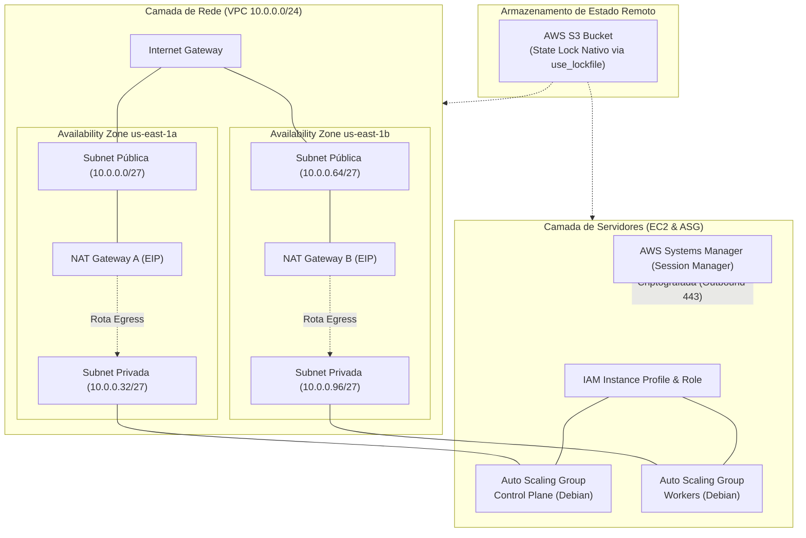
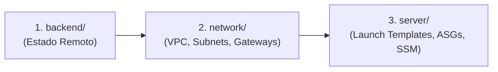

# NSSE - Not-So-Simple E-commerce (Infrastructure as Code)

> [!IMPORTANT]
> **Autoria do Código e Uso de Inteligência Artificial**
> - **Desenvolvimento Manual do Código**: Todo o código presente neste repositório (arquivos HCL/Terraform, configurações de infraestrutura e scripts Shell) está sendo escrito e desenvolvido **manualmente** pelo autor à medida que estuda e acompanha as aulas práticas.
> - **Uso Estrito de LLM**: O uso de modelos de linguagem (LLM) neste repositório é restrito **exclusivamente** à geração e melhoria de documentação técnica, revisões gramaticais, elaboração de diagramas conceituais e estruturação pedagógica das anotações de estudo.

Repositório dedicado ao provisionamento e gerenciamento da infraestrutura em nuvem na **Amazon Web Services (AWS)** utilizando **Terraform** para o projeto **NSSE (Not-So-Simple E-commerce)**. 

O código-fonte da aplicação de e-commerce será versionado e integrado a esta infraestrutura em etapas futuras.

---

## 🏛️ Visão Geral da Arquitetura

A infraestrutura foi desenhada seguindo as melhores práticas de isolamento de estado, alta disponibilidade (Multi-AZ), segurança em camadas (Least Privilege e Zero Trust) e escalabilidade automatizada:



---

## 📁 Estrutura do Repositório

O repositório é desacoplado em diretórios independentes com estados remotos segregados para mitigar riscos de alterações cruzadas (*blast radius* reduzido):

```
nsse-iac/
├── backend/                # Definição e configuração do backend remoto S3
│   ├── main.tf             # Bloco terraform com backend s3 e provider AWS
│   ├── variables.tf        # Declaração das variáveis do backend
│   └── terraform.tfvars.example # Modelo de variáveis para o backend
├── network/                # Módulo de Rede e Conectividade
│   ├── main.tf             # Backend s3 (chave: prod/network.tfstate) e provider
│   ├── vpc.tf              # Recurso aws_vpc
│   ├── vpc.internet-gateway.tf # Roteador de borda (aws_internet_gateway)
│   ├── vpc.public-subnets.tf   # Sub-redes públicas (Multi-AZ)
│   ├── vpc.private-subnets.tf  # Sub-redes privadas (Multi-AZ)
│   ├── ec2.eips.tf         # Elastic IPs para os NAT Gateways
│   ├── vpc.nat_gateways.tf # NAT Gateways (1 por AZ pública)
│   ├── vpc.public-route-table.tf   # Tabela de rotas públicas -> IGW
│   ├── vpc.private-route-tables.tf  # Tabelas de rotas privadas -> NAT GW
│   ├── outputs.tf          # Exportação de IDs da VPC, subnets e gateways
│   ├── variables.tf        # Variáveis tipadas para a rede
│   └── terraform.tfvars.example # Valores de exemplo para rede
├── server/                 # Módulo de Computação e Gerenciamento
│   ├── main.tf             # Backend s3 (chave: prod/server.tfstate) e provider
│   ├── data.vpc.tf         # Consulta à VPC via Data Source
│   ├── data.vpc.private-subnets.tf # Consulta às sub-redes privadas
│   ├── data.ec2-ami.tf     # Data Source para busca dinâmica da AMI Debian
│   ├── ec2.instance-profile.tf # IAM Role e Instance Profile (permissões SSM)
│   ├── ec2.key-pair.tf     # Key Pair gerada via provider TLS (fallback)
│   ├── ec2.security-group-control-plane.tf # Security Group do Control Plane
│   ├── ec2.security-group-worker.tf        # Security Group dos Workers
│   ├── ec2.instances.control-plane.tf      # ASG do Control Plane
│   ├── ec2.instances.worker.tf             # ASG dos Workers
│   ├── modules/
│   │   └── ec2/            # Módulo reutilizável para EC2
│   │       ├── ec2.launch-template.tf      # Modelo com specs da máquina
│   │       ├── ec2.auto-scaling-group.tf   # Pool com resiliência e manutenção
│   │       ├── variables.tf
│   │       └── outputs.tf
│   ├── cli/
│   │   ├── control-plane-user-data.sh      # Instalação do SSM Agent
│   │   └── worker-user-data.sh             # Instalação do SSM Agent
│   ├── outputs.tf
│   ├── variables.tf
│   └── terraform.tfvars.example
└── notes/                  # Caderno de Estudos com Anotações e Diagramas
    ├── terraform.md        # Boas práticas de Terraform, Backends e Variáveis
    ├── aws-network.md      # Fundamentos de Redes na AWS (CIDR, VPC, Gateways)
    ├── aws-compute.md      # Computação AWS (AMIs, Launch Templates, ASG, SSM)
    └── images/             # Diagramas e ilustrações técnicas dos tópicos
```

---

## 🚀 Como Executar o Projeto

### Pré-requisitos
- [Terraform](https://developer.hashicorp.com/terraform/downloads) instalado (versão `>= 1.11.0`).
- [AWS CLI](https://aws.amazon.com/cli/) instalado e configurado com as credenciais ou permissões para `sts:AssumeRole`.
- Permissões adequadas na AWS para criação de recursos de rede, computação, IAM e S3.

### Ordem de Provisionamento

Para respeitar as dependências de infraestrutura, execute os módulos na seguinte sequência:



#### 1. Camada de Backend (`backend/`)
Configura o remote state onde as informações de estado do Terraform serão armazenadas de forma centralizada e segura.
```bash
cd backend
cp terraform.tfvars.example terraform.tfvars
# Edite o arquivo terraform.tfvars com os dados de sua conta/região
terraform init
terraform plan
terraform apply
```

#### 2. Camada de Rede (`network/`)
Cria a VPC, Internet Gateway, Sub-redes públicas e privadas Multi-AZ, Elastic IPs, NAT Gateways e tabelas de rotas.
```bash
cd ../network
cp terraform.tfvars.example terraform.tfvars
# Preencha o terraform.tfvars com o bloco CIDR e configurações desejadas
terraform init
terraform plan
terraform apply
```

#### 3. Camada de Servidores (`server/`)
Localiza as sub-redes e VPC através de Data Sources, define os Launch Templates, provisiona os Auto Scaling Groups para Control Plane e Workers, configura o IAM Instance Profile e injeta o AWS SSM Agent nas máquinas via script de inicialização (`user_data`).
```bash
cd ../server
cp terraform.tfvars.example terraform.tfvars
# Configure os parâmetros dos nós e instâncias
terraform init
terraform plan
terraform apply
```

---

## 🔐 Práticas de Segurança Implementadas

1. **Acesso Seguro via AWS Systems Manager (SSM)**:
   - Acesso via terminal às instâncias EC2 através do **SSM Session Manager**, eliminando a necessidade de expor a porta 22 (SSH) para a Internet ou manter Bastion Hosts.
   - O tráfego de gerenciamento é criptografado e originado de dentro para fora (Outbound TLS na porta 443) pelo agente SSM.
2. **Sem Segredos Estáticos nas Instâncias**:
   - Nenhuma chave de API ou credencial permanente é gravada no sistema operacional ou no repositório Git.
   - Utilização de **IAM Instance Profiles** que concedem credenciais temporárias do AWS STS renovadas automaticamente.
3. **Isolamento de Cargas em Subnets Privadas**:
   - Servidores residem em sub-redes privadas sem IPs públicos diretos, alcançando a internet exclusivamente via **NAT Gateways** dedicados por Zona de Disponibilidade.
4. **State Locking Nativo no S3**:
   - Uso da funcionalidade `use_lockfile = true` do Terraform moderno, garantindo proteção contra execuções concorrentes sem a necessidade legada de tabelas DynamoDB dedicadas.

---

## 📚 Caderno de Estudos e Anotações Técnicas

Para documentar os conceitos teóricos e decisões de arquitetura aprendidos ao longo das aulas, o diretório [`notes/`](notes/) disponibiliza guias detalhados complementados com exemplos e ilustrações:

- 📘 [**Anotações de Terraform**](notes/terraform.md): State locking no S3 nativo vs DynamoDB, organização de arquivos e variáveis, pipeline de dependência de recursos e chaves TLS.
- 🌐 [**Anotações de Redes AWS**](notes/aws-network.md): Endereçamento CIDR, reserva de 5 IPs da AWS, VPC, alta disponibilidade Multi-AZ, diferenças operacionais entre NAT Gateway e Internet Gateway.
- 💻 [**Anotações de Computação AWS**](notes/aws-compute.md): AMIs, Launch Templates, Auto Scaling Groups, políticas de manutenção, IAM Instance Profile e gerenciamento via AWS Systems Manager.
