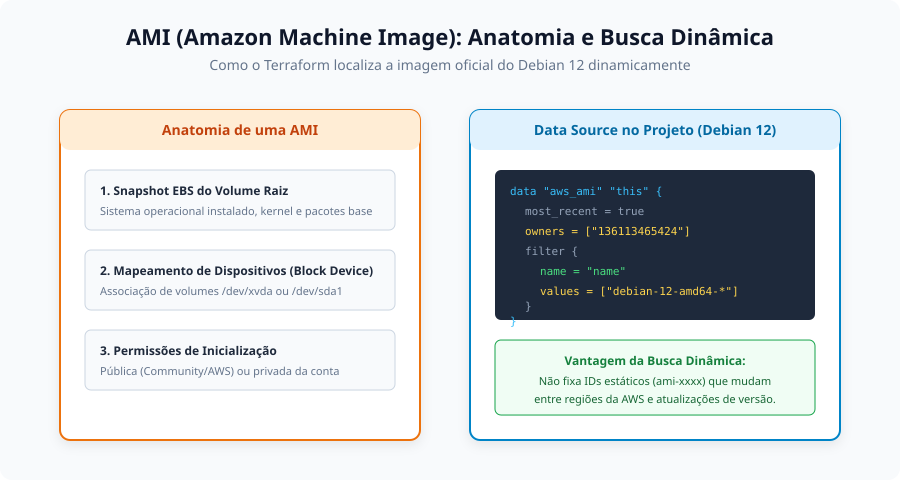
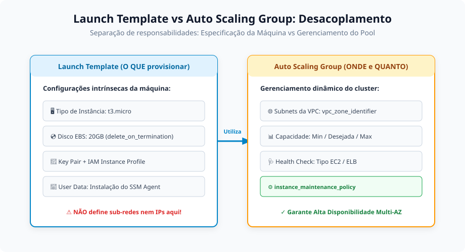
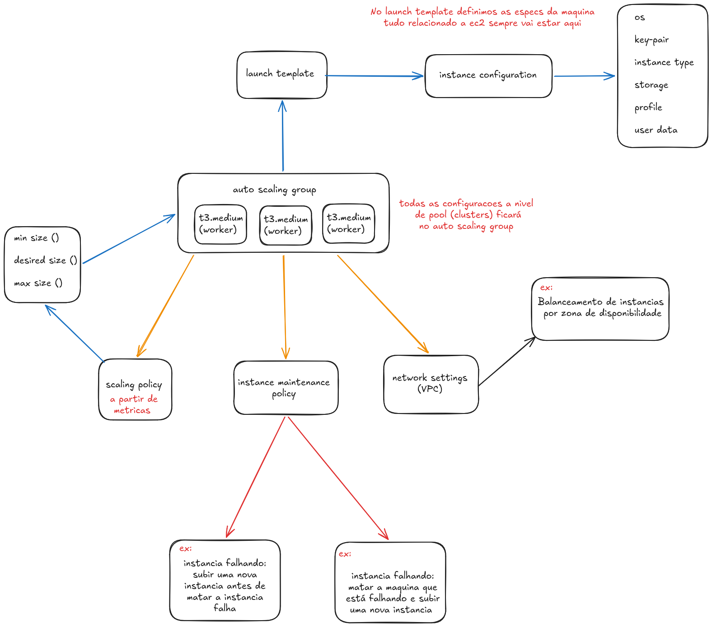
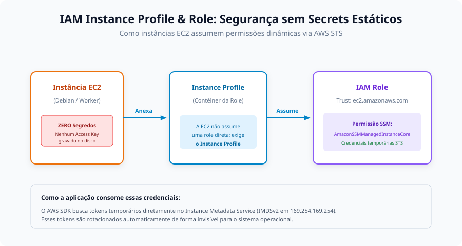
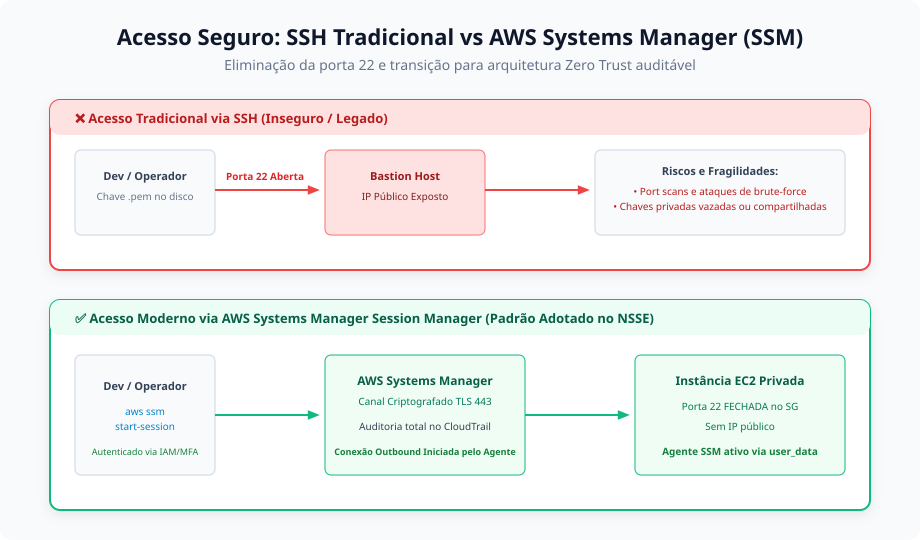

# Anotações de Estudo: Computação na AWS (EC2, ASG e SSM)

Este documento aprofunda os conceitos de computação em nuvem na **Amazon Web Services (AWS)**, detalhando os padrões de projeto, segurança e escalabilidade implementados no módulo `server` deste repositório.

---

## 1. AMI (Amazon Machine Image) e Ciclo de Vida de Imagens

Uma **AMI** é o modelo base que contém todas as informações necessárias para inicializar uma instância virtual EC2. Ela encapsula o sistema operacional, o servidor de arquivos pré-configurado, o kernel e o particionamento de disco.



### Estrutura de uma AMI
1. **Snapshot EBS do Volume Raiz**: Cópia pontual do sistema de arquivos contendo o sistema operacional e eventuais softwares pré-instalados.
2. **Mapeamento de Dispositivos de Bloco (Block Device Mapping)**: Define quais volumes e partições são anexados à instância durante a inicialização (ex: tamanho e tipo de disco `/dev/xvda`).
3. **Permissões de Lançamento**: Define se a imagem é pública (mantida pela AWS ou comunidade) ou privada (restrita à conta da organização).

### Critérios de Escolha do Sistema Operacional
- **Amazon Linux**: Otimizado para a nuvem da AWS, incluindo suporte nativo e pré-instalado ao AWS CLI, SSM Agent e CloudWatch.
- **Debian (Opção adotada no NSSE)**: Conhecido mundialmente pela estabilidade máxima, ausência de pacotes proprietários desnecessários e controle refinado sobre dependências e segurança.
- **Red Hat Enterprise Linux (RHEL) / Ubuntu**: Utilizados frequentemente em ambientes que exigem suporte empresarial homologado ou amplo ecossistema de contêineres e IA.

### Busca Dinâmica via Terraform Data Source
Em vez de gravar manualmente um ID fixo de imagem (que muda frequentemente por patches de segurança e varia entre regiões), o projeto localiza dinamicamente a versão oficial mais recente do Debian 12:

```hcl
data "aws_ami" "this" {
  most_recent = true
  owners      = ["136113465424"] # ID da conta oficial da Debian na AWS

  filter {
    name   = "name"
    values = ["debian-12-amd64-*"]
  }
}
```

---

## 2. Launch Template (Modelo de Inicialização)

O **Launch Template** centraliza e padroniza todas as especificações das instâncias EC2, garantindo que máquinas adicionadas pelo Auto Scaling sigam o mesmo padrão operacional.



### O Princípio do Desacoplamento (O QUE vs. ONDE)
- **O QUE é definido no Launch Template**:
  - Família e tamanho de hardware da máquina (ex: `t3.micro`).
  - Tipo e tamanho de armazenamento persistente EBS (ex: 20 GB gp3 com `delete_on_termination = true`).
  - Identidade de segurança: `iam_instance_profile` e Security Groups.
  - Script de inicialização (`user_data`) para bootstrap automatizado.
  - Par de chaves SSH (`key_name`) para resgate de emergência.
  - Proteções contra paradas ou exclusões acidentais (`disable_api_termination = true`, `disable_api_stop = true`).
- **O QUE NÃO deve ser definido no Launch Template**:
  - Sub-redes específicas da VPC e alocação de IPs. Essa responsabilidade pertence ao **Auto Scaling Group**, permitindo que o mesmo template lance instâncias em qualquer Zona de Disponibilidade.

---

## 3. Auto Scaling Group (ASG) e Resiliência de Cluster

Em ambientes de produção modernos, criar instâncias EC2 isoladas e estáticas é considerado um antipadrão (*anti-pattern*). Para assegurar alta disponibilidade, auto-recuperação (*self-healing*) e eficiência de custos, utilizamos o **Auto Scaling Group**.



### Dimensões de Capacidade do Pool
- **Capacidade Mínima (`min_size`)**: Quantidade mínima de instâncias que o cluster deve manter ativas, mesmo em períodos de baixíssima demanda.
- **Capacidade Desejada (`desired_capacity`)**: Quantidade alvo de servidores em operação normal.
- **Capacidade Máxima (`max_size`)**: Teto de escalonamento para absorver picos de tráfego sem extrapolar o orçamento da organização.

### Política de Manutenção de Instâncias (`instance_maintenance_policy`)
Configuração moderna que define como o ASG lida com substituição de instâncias com falha ou atualizações graduais (*rolling deployments*):

```hcl
instance_maintenance_policy {
  min_healthy_percentage = 100 # Garante 100% da capacidade ativa durante rollouts
  max_healthy_percentage = 200 # Permite subir uma nova instância saudável ANTES de desligar a antiga
}
```
- **`min_healthy_percentage = 100`**: Nenhuma instância em produção é desligada sem que haja capacidade suficiente atendendo requisições.
- **`max_healthy_percentage = 200`**: O ASG provisiona primeiro o novo nó; somente após o novo servidor passar nos *health checks* com sucesso, o nó antigo ou com problemas é drenado e terminado.

### Distribuição Multi-AZ
Através do parâmetro `vpc_zone_identifier = data.aws_subnets.private_subnets.ids`, o ASG distribui o balanceamento de servidores igualmente entre as zonas `us-east-1a` e `us-east-1b`, garantindo tolerância a falhas em nível de datacenter.

---

## 4. IAM Role, Instance Profile e Segurança sem Segredos Estáticos

Uma das falhas mais graves de segurança em infraestrutura é salvar credenciais estáticas (`AWS_ACCESS_KEY_ID` e `AWS_SECRET_ACCESS_KEY`) em arquivos `.env`, scripts ou variáveis de ambiente de servidores.



### Como Funciona a Cadeia de Confiança
1. **EC2 Instance Profile**: Na AWS, uma instância EC2 não pode assumir uma `aws_iam_role` diretamente. O *Instance Profile* atua como o recipiente ou envelope formal que vincula a role à interface da máquina virtual.
2. **IAM Role com AssumeRole**: A role possui uma política de confiança (*Trust Relationship*) autorizando o serviço EC2 (`ec2.amazonaws.com`) a assumir a identidade via `sts:AssumeRole`.
3. **Credenciais Temporárias via AWS STS**: O AWS Security Token Service (STS) gera credenciais de curto prazo que são injetadas diretamente no serviço de metadados da instância (**IMDSv2** em `http://169.254.169.254/`). Essas credenciais são renovadas automaticamente a cada poucas horas de forma totalmente transparente para a aplicação.

```hcl
# 1. Política de confiança (quem pode assumir)
data "aws_iam_policy_document" "assume_role" {
  statement {
    effect  = "Allow"
    actions = ["sts:AssumeRole"]
    principals {
      type        = "Service"
      identifiers = ["ec2.amazonaws.com"]
    }
  }
}

# 2. Criação da Role
resource "aws_iam_role" "role" {
  name               = var.ec2_resources.instance_role
  assume_role_policy = data.aws_iam_policy_document.assume_role.json
}

# 3. Instance Profile atrelado à Role
resource "aws_iam_instance_profile" "instance_profile" {
  name = var.ec2_resources.instance_profile
  role = aws_iam_role.role.name
}
```

---

## 5. AWS Systems Manager (SSM) Session Manager e Eliminação do SSH

O **AWS Systems Manager (SSM)** é a central unificada de gerenciamento de frotas e operações da AWS. Um de seus principais recursos é o **Session Manager**, que substitui totalmente a necessidade do protocolo SSH tradicional.



### Por que Abandonar o SSH Tradicional (Porta 22)?
- **Eliminação de Bastion Hosts**: Não é necessário pagar nem manter instâncias intermediárias de salto (*jump servers*) expostas à Internet.
- **Porta 22 Fechada no Firewall**: O Security Group das instâncias não possui nenhuma regra de entrada (*ingress*) para a porta 22. Varreduras de porta e ataques de força bruta (*brute-force*) externos são completamente inviabilizados.
- **Sem Gestão de Chaves `.pem`**: Não há risco de operadores perderem chaves privadas ou compartilharem arquivos confidenciais via canais inseguros.
- **Autenticação Centralizada e Auditoria**: O acesso é validado pelo AWS IAM (com suporte a MFA) e todas as sessões e comandos executados no terminal são registrados integralmente no **AWS CloudTrail** e **CloudWatch Logs**.

### Instalação Automatizada via `user_data`
Para que a instância se conecte ao Systems Manager, ela precisa rodar o **Amazon SSM Agent**. No projeto NSSE, a instalação é automatizada na primeira inicialização da máquina via script shell Debian (`server/cli/control-plane-user-data.sh` e `worker-user-data.sh`):

```bash
#!/bin/bash

function installSystemsManagerAgentOnEc2() {
    apt-get update -y
    mkdir -p /tmp/ssm
    cd /tmp/ssm

    if [ ! -f "amazon-ssm-agent.deb" ]; then
        wget https://s3.amazonaws.com/ec2-downloads-windows/SSMAgent/latest/debian_amd64/amazon-ssm-agent.deb
    fi

    dpkg -i amazon-ssm-agent.deb
}

installSystemsManagerAgentOnEc2
```

### Como Conectar à Instância via Terminal
Com o agente instalado e a role autorizada com a política `AmazonSSMManagedInstanceCore`, o desenvolvedor conecta-se com um único comando CLI sem precisar de chave SSH:
```bash
aws ssm start-session --target <ID-DA-INSTANCIA-EC2>
```

> [!NOTE]
> **Política de Fallback da Key Pair**:
> Embora o Security Group não exponha o SSH para a Internet, mantemos o par de chaves SSH registrado no Launch Template. Em um cenário extremo de falha do agente SSM ou de isolamento temporário de rede, a chave permite restabelecer conectividade emergencial via rede privada interna sem a necessidade de descartar os volumes da máquina.
