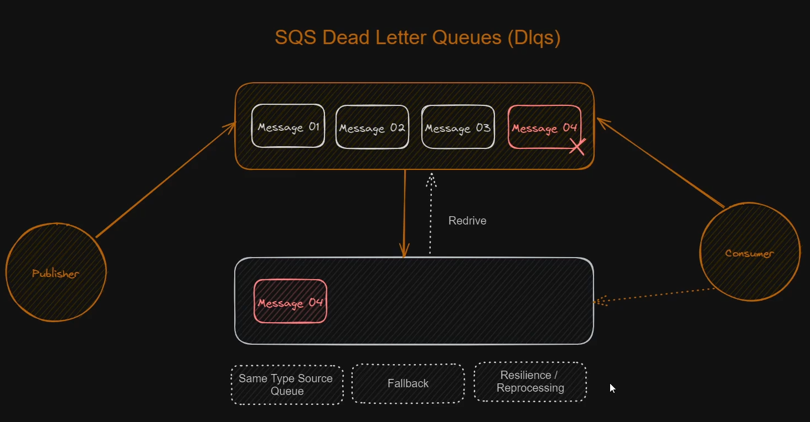

Conceito de filas e mensageria, é uma maneira de mantermos a resiliciencia pensando em cenários de pico, por exemplo uma black friday, filas sao utilizadas em cenarios de trabalhos assincronos, que nao precisam de um retorno imediato, um exemplo disso em uma aplicacao real é a compra em um e-commerce, a nota fiscal chega bem depois de realizarmos a compra, ou seja, a partir do momento que o pagamento é confirmado, é dado baixa no estoque, o status do pedido é trocado de pendente para pago e a nota fiscal entra em uma fila que será disparada de tempos em tempos contendo pedidos de nota fiscal de diferentes clientes, nisso o sistema ja seguiu seu fluxo  normalmente, se fosse de forma sincrona o usuário ficaria aguardando na tela enquanto todo o backend processa, isso elevaria os gastos absurdamente com escalabilidade e poder computacional, em um cenário de black friday nem se fala, a imagem do diagrama apresentado no curso, propoem que seja desaclopado e escalavel.

Mensageria

em termos simples, refere-se a troca de mensagens entre sistemas através de um intermediário, ou seja, um midware, isso permite a comunicacao entre diferentes sistemas em diferentes linguagens. Baseia-se no conceito de producao e consumidor, acho que pra definir isso aqui de uma maneira mais simples, seria aquelas notificas que recebemos no e-mail, quando assinamos um jornal virtual, exemplo o thenews, eu sou um consumidor do thenews, que faz suas publicacoes, ou seja, sou um microservico que estou "escutando", esperando ele publicar para que eu possa consumir aquela mensagem/conteudo que nesse caso seria a noticia enviada no e-mail.

levando para o rumo comercial, eu poderia ter o caso do ecommerce, que quando o cliente paga, o sistema faz varias coisas de maneira assincrona que o cliente nao ve, como emissao de nota fiscal, emissao do pedido pra logistica atuar, atualizacao do estoque, tem varias coisas que podem ser utilizadas como exemplo.

Fidelis em seu blog fala: Estabelecer um canal comum entre o destinatário e o remetente da mensagem é uma premissa para que esse tipo de abordagem funcione bem.
Ou seja, pra funcionar bem, os dois lados tem que utilizar um protocolo igual para que funcione, existem varios como JMS, AMQP MQTT STOMP, MSMQ, os legais aqui sao o AMQP que é pra ser um protocolo universal entao basta verificar se a linguagem tem suporte, umma solucao que utiliza desse protocolo é o RabbitMQ, o outro protocolo usado em uma tecnologia bem conhecida é o STOMP que é utilizado pelo Kafka.

detalhes sobre os protocolos voce encontra ai na internet, tem um artigo muito bom que fala sobre mensageria e os protocolos é o https://www.sensedia.com.br/post/o-que-e-mensageria-tudo-o-que-voce-precisa-saber

Aqui sao minhas anotacoes de estudo de varias fontes diferentes, aqui ta detalhado o que eu acho importante pra mim revisitar depois.

é comum ouvir o nome Broker que seria o midware, que por sua vez seria alguma dessas solucoes como kafka e rabbitMQ

Ate o momento nao sei se é muito utilizado o modelo de mensageria point to point, que permite o envio apenas de 1 por 1, uma mensagem com 1 componente por vez, para cada assinante.

Um que eu ja vi em alguns sitemas de colegas e materias de estudo é o publish/subscribre, na GCP tem um recurso de mensageria que chama pub/sub. faz o que eu to escrevendo aqui. é o servico gerenciado da GCP, assim como a AWS tem o SQS.

Para escalar esse servico, é preciso utilizar varios servidores, onde a tecnologia vai gravar em varios servidores pra nao perder a mensagem, entao na hora do envio, pode ser que vá algo duplicado, nao espere ordem aqui, pelomenos nao no servico standart, na AWS o SQS é standart ou FIFO, o FIFO aplica aquela estrutura de dados que aprendemos na faculdade, first in first out, quando trabalhamos com filas e mensageria, é praticamente obrigatorio que a aplicacao seja idenpotente, ela tem que conseguir filtrar que veio duplicado, fora de ordem e etc. 

o conceito de Dead Letter Queues é uma fila secundaria destinada a erros, caso ocorra qualquer problema com alguma mensagem, deixamos configurado para mandar pra essa fila secundaria, nela tomamos acoes para investigar, tentar resolver, componentes que estao com erros podem ser disparados novamente, nessas filas. ajuda bastante no throubleshooting

Na aws é mais simples. tras commodit em algumas coisas, como esse processo da fila secundaria é bem mais simples criar e gerenciar utilizando o servico deles do que fazer tudo na mao.

ah, tem a politica de redrive, que se der erro e cair na fila de baixo, ela reencaminha pra fila principal e tenta novamente.

trade offs abaixo: (ajuda do geminelson)
1. O Ecossistema de Mensageria na AWS: Escolhendo a Ferramenta Correta

O primeiro erro comum em projetos iniciantes é tentar usar uma única ferramenta para resolver padrões de comunicação completamente distintos.

    Amazon SQS (Fila Ponto a Ponto):

        Conceito: Comunicação 1 para 1. Uma mensagem entra na fila e apenas um único consumidor deve pegá-la, processá-la e removê-la.

        Quando usar: Distribuição de tarefas assíncronas em segundo plano (background jobs), controle de fluxo e nivelamento de carga (load leveling).

    Amazon SNS (Publicação/Assinatura - Pub/Sub):

        Conceito: Comunicação 1 para N (Fan-out). Um produtor envia uma mensagem para um tópico, e todos os múltiplos assinantes interessados (filas SQS, endpoints HTTP, Lambdas, e-mails) recebem cópias simultâneas.

        Quando usar: Notificações em massa e quando vários subsistemas independentes precisam reagir ao mesmo evento.

    Amazon EventBridge (Barramento de Eventos):

        Conceito: Roteador inteligente de eventos (Event Bus). Capaz de inspecionar o conteúdo (payload) do JSON e direcionar o evento para dezenas de serviços diferentes com base em regras detalhadas.

        Trade-off frente ao SNS: O EventBridge oferece maior flexibilidade de roteamento, esquema estruturado (Schema Registry) e integração nativa com centenas de serviços SaaS e AWS, porém tem latência ligeiramente superior ao SNS e limites de taxa de transferência mais baixos por padrão.

    Amazon Kinesis / Apache Kafka (Event Streaming):

        Conceito: Log sequencial append-only particionado. As mensagens não são apagadas após o consumo; os dados persistem pelo tempo de retenção configurado e consumidores leem via ponteiros (offsets).

        Trade-off frente ao SQS: O Kinesis/Kafka suporta ordenação por partição em altíssima escala e permite que novos consumidores leiam dados do passado (replay), mas exige gestão complexa de shards/partições e balanceamento de consumidores.

2. Boas Práticas e Trade-offs no Amazon SQS
A. Long Polling vs. Short Polling

    Como funciona: No Short Polling (tempo de espera configurado em 0 segundos), a aplicação consulta o SQS e a AWS responde imediatamente, mesmo se a fila estiver vazia. No Long Polling (ReceiveMessageWaitTimeSeconds configurado entre 1 e 20 segundos), a conexão permanece aberta aguardando novas mensagens chegarem antes de responder.

    Boa prática: Configure sempre o Long Polling (idealmente em 20 segundos).

    O ganho: Redução expressiva na fatura da AWS (o SQS cobra por requisição da API ReceiveMessage) e eliminação de consumo inútil de CPU nas aplicações consumidoras gerado por consultas vazias em loop.

    B. Visibility Timeout (Tempo de Visibilidade)

    Como funciona: Quando um consumidor lê uma mensagem, o SQS não a apaga imediatamente; ele a torna invisível temporariamente para que outros consumidores não a peguem ao mesmo tempo.

    O trade-off do dimensionamento:

        Curto demais: Se o processamento demorar 40 segundos e o tempo de visibilidade for de 30 segundos, a mensagem voltará a ficar visível enquanto o primeiro consumidor ainda está trabalhando nela. Um segundo consumidor pegará a mesma mensagem, gerando processamento duplicado desnecessário.

        Longo demais: Se o consumidor falhar ou a máquina cair logo no início do processamento, a mensagem ficará travada e invisível durante todo esse período antes de outro consumidor poder tentar novamente.

    Regra prática: Defina o Visibility Timeout para pelo menos 6 vezes o tempo médio de resposta da sua aplicação, ou faça a aplicação estender o tempo via API (ChangeMessageVisibility) caso detecte tarefas mais longas.

C. Dead Letter Queue (DLQ) e Mensagens Venenosas (Poison Pills)

    O problema: Uma mensagem malformatada (ex.: um JSON corrompido que lança uma exceção não tratada) fará o consumidor quebrar repetidamente. O SQS recoloca a mensagem na fila, outro consumidor a lê, quebra novamente, e isso se repete infinitamente, travando recursos e poluindo métricas.

    A solução: Vincular obrigatoriamente uma DLQ (Fila de Mensagens Mortas) à fila principal com uma política de redirecionamento (Redrive Policy).

    Definição do maxReceiveCount: Configura quantas vezes uma mensagem pode falhar antes de ser expulsa para a DLQ (geralmente entre 3 e 5 tentativas). Números muito baixos (como 1) enviam mensagens para a DLQ em oscilações momentâneas de rede; números muito altos retardam o isolamento de falhas sistêmicas.

D. Idempotência do Consumidor

    Em filas SQS Standard, a AWS garante a entrega pelo menos uma vez (at-least-once delivery). Isso significa que, por questões de redundância interna de servidores, a mesma mensagem vai chegar duplicada em algum momento da operação.

    Princípio fundamental: O consumidor precisa ser idempotente. Processar a mesma mensagem duas vezes deve produzir exatamente o mesmo efeito de processá-la uma vez só (ex.: salvar um identificador único de transação em cache/banco com verificação prévia antes de efetivar pagamentos ou envios).

    3. O Padrão Fan-Out (SNS + SQS)

Um dos erros mais comuns de acoplamento é fazer o serviço de origem enviar a mesma mensagem individualmente para 4 filas SQS diferentes de 4 equipes distintas. Se uma 5ª equipe precisar do dado, o código do serviço de origem precisa ser modificado e redeployado.
Plaintext

                  +-------------------+
                  |  Serviço Produtor |
                  +---------+---------+
                            |
                   (Publica 1 vez só)
                            v
                  +-------------------+
                  |    Tópico SNS     |
                  +---------+---------+
                            |
          +-----------------+-----------------+
          |                                   |
          v                                   v
+-------------------+               +-------------------+
|     Fila SQS      |               |     Fila SQS      |
|  (Time de Vendas) |               |  (Time Antifraude)|
+---------+---------+               +---------+---------+
          |                                   |
          v                                   v
+-------------------+               +-------------------+
| Worker de Vendas  |               | Worker Antifraude |
+-------------------+               +-------------------+

    Benefício: O produtor só conhece o tópico do SNS. Novos times adicionam novas filas SQS como assinantes do tópico diretamente na infraestrutura, sem tocar em uma linha do código de quem envia a mensagem.

    Isolamento de falhas (Blast Radius): Se o time Antifraude tiver uma pane e parar de consumir da sua fila SQS, a fila do time de Vendas continua funcionando normalmente, sem acúmulo nem impacto cruzado.

4. Boas Práticas de Segurança e Políticas de Acesso

    Criptografia em Repouso:

        Ativar SSE (Server-Side Encryption) utilizando AWS KMS.

        Trade-off: Usar a chave padrão gerenciada pela AWS (alias/aws/sqs) é gratuito e sem fricção de configuração, mas usar uma chave gerenciada pelo cliente (CMK) permite definir rotação anual automática e auditoria fina no CloudTrail sobre quem lê e descriptografa mensagens.

    IAM Roles vs. Resource-based Policies:

        No SQS e SNS, as permissões são controladas tanto pelas permissões do consumidor (IAM Role/Policy) quanto pela própria política anexada à fila/tópico (Queue Policy / Topic Policy).

        Sempre restrinja o bloco Principal na política do recurso para permitir apenas as Roles específicas dos pods/instâncias autorizadas, evitando o uso de Principal: "*" mesmo em contas internas.

        5. Métricas Críticas para Observabilidade e DimensionamentoTrabalhar com mensageria muda a forma de escalar aplicações. Escalar uma frota de consumidores baseando-se apenas em uso de CPU ou Memória é insuficiente, pois a CPU pode estar baixa enquanto milhares de mensagens acumulam na fila.ApproximateNumberOfMessagesVisible: Quantidade de mensagens prontas para serem processadas. Serve para avaliar a profundidade do acúmulo.ApproximateAgeOfOldestMessage (A métrica mais importante para SRE): Informa a idade (em segundos) da mensagem mais antiga que ainda não foi consumida.Por que ela é crucial: Se a fila tem 500 mensagens, mas a mensagem mais velha tem apenas 2 segundos de vida, o sistema está saudável. Se a fila tem 10 mensagens, mas a mais velha tem 45 minutos de vida, seus consumidores estão travados ou a taxa de saída é inferior à taxa de entrada.Alarmes na DLQ: Qualquer mensagem caindo em uma Dead Letter Queue (ApproximateNumberOfMessagesVisible > 0) deve disparar um alarme imediato, pois indica descarte de mensagens que falharam após todas as tentativas.Resumo dos Trade-Offs FundamentaisDecisãoVantagemPreço a Pagar / DesvantagemSQS Standard vs FIFOStandard tem throughput quase ilimitado e menor custo.Exige tolerância a mensagens fora de ordem e deduplicação idempotente no consumidor.SQS vs Streaming (Kafka/Kinesis)SQS gerencia tudo, escala automaticamente do zero sem provisionamento de nós/shards.Não permite reprocessar dados passados (replay) nem suporta múltiplos consumidores lendo o mesmo item.SNS + SQS vs Chamada Direta HTTPDesacoplamento total, proteção contra quedas de serviços downstream.Introduz consistência eventual (o dado não aparece instantaneamente em todos os lugares) e complexidade de rastreabilidade distribuída.

Bom, neste curso essas anotações são o bastante, se quiser ir mais afundo tem o mestre fidelis, com o seguinte artigo: https://fidelissauro.dev/mensageria-eventos-streaming/
aqui ta bem detalhado, bem foda o conteudo dele, eu tenho o livro digital, que é um dump do blog, porém organizado e com algumas partes reescritas, o conteudo de um não  é o conteudo do outro, palavras do proprio fidelis, a producao do livro ta bem foda, e na data desse commit aqui ainda é possivel comprar na pre venda a edicao fisica. espero que minha namorada me de o livro físico de presente.

