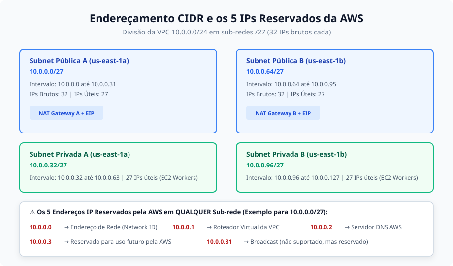
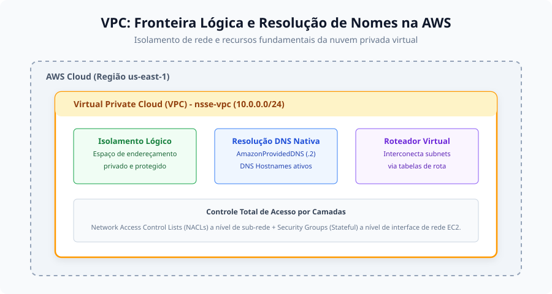
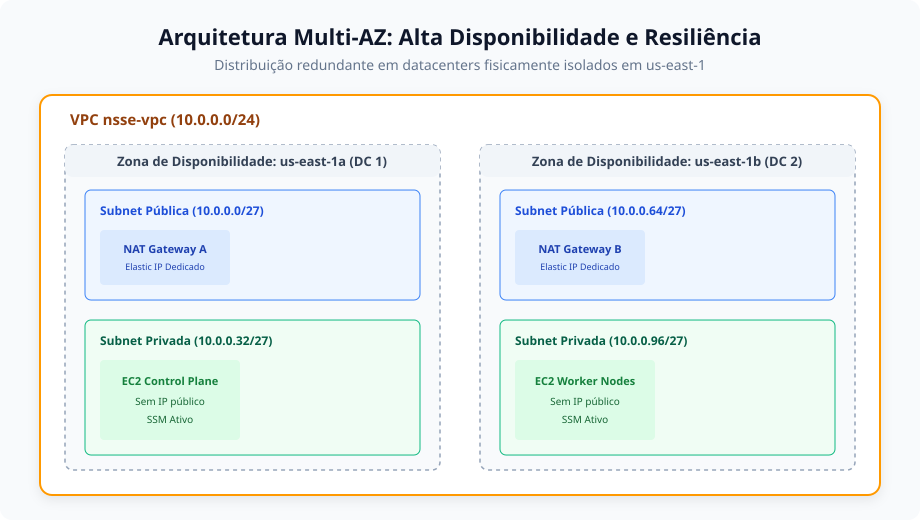
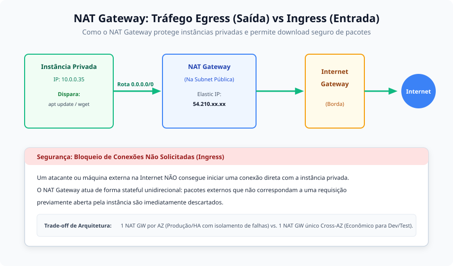
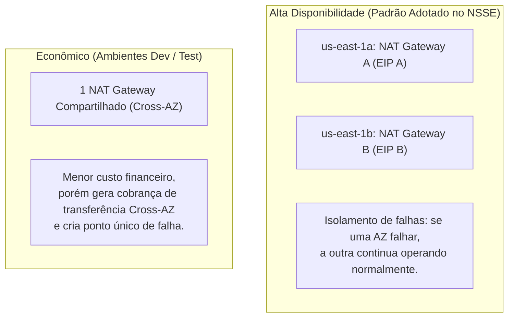
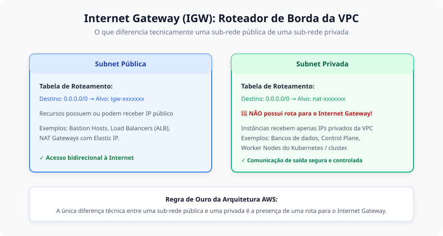
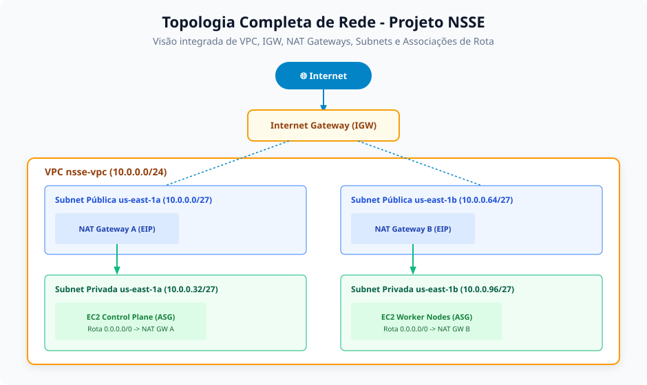

# Anotações de Estudo: Redes na AWS (Networking)

Este documento aborda os conceitos essenciais de arquitetura de rede na **Amazon Web Services (AWS)**, conectando os fundamentos teóricos às implementações reais realizadas no módulo `network` deste repositório.

---

## 1. CIDR (Classless Inter-Domain Routing) e Planejamento de IPs

O CIDR é o método padrão de alocação de endereços IP e roteamento na Internet e em redes em nuvem. A notação consiste no IP base seguido de uma barra e a máscara de rede (ex: `10.0.0.0/24`), que define quantos bits são fixos para a identificação da rede e quantos restam para os hosts.

### Os 5 Endereços IP Reservados pela AWS em Toda Sub-rede

Diferente de redes locais tradicionais (onde apenas o primeiro e o último IP são reservados para rede e broadcast), **a AWS reserva obrigatoriamente os primeiros 4 endereços e o último endereço de qualquer bloco de sub-rede**:

| Endereço IP (Exemplo para `10.0.0.0/27`) | Finalidade na AWS |
| :--- | :--- |
| `10.0.0.0` | **Endereço da Rede (Network ID)** |
| `10.0.0.1` | **Roteador Virtual da VPC** (Default Gateway da sub-rede) |
| `10.0.0.2` | **Servidor DNS da AWS** (Resolvedor `AmazonProvidedDNS`) |
| `10.0.0.3` | **Reservado pela AWS** para uso futuro |
| `10.0.0.31` | **Endereço de Broadcast** (A VPC não suporta broadcast, mas reserva o IP) |

> [!IMPORTANT]
> **Cálculo de Capacidade de Hosts**:  
> Em uma sub-rede `/27`, temos $2^{(32 - 27)} = 32$ endereços IP brutos.  
> Descontando os **5 IPs reservados pela AWS**, restam **27 IPs úteis** para instâncias EC2, interfaces de rede (ENIs) ou balanceadores de carga.

### Divisão no Projeto NSSE (`10.0.0.0/24`)
No arquivo `network/terraform.tfvars.example`, o bloco global da VPC é dividido harmonicamente:
- **Pública A (`us-east-1a`)**: `10.0.0.0/27` (Faixa: `10.0.0.0` – `10.0.0.31`)
- **Privada A (`us-east-1a`)**: `10.0.0.32/27` (Faixa: `10.0.0.32` – `10.0.0.63`)
- **Pública B (`us-east-1b`)**: `10.0.0.64/27` (Faixa: `10.0.0.64` – `10.0.0.95`)
- **Privada B (`us-east-1b`)**: `10.0.0.96/27` (Faixa: `10.0.0.96` – `10.0.0.127`)

---

## 2. VPC (Virtual Private Cloud)

A VPC é a rede virtual isolada e dedicada à sua conta na AWS. Ela estabelece uma fronteira de segurança lógica para todos os recursos corporativos na nuvem.

### Características Fundamentais
- **Espaço de Endereçamento Próprio**: Permite escolher faixas privadas RFC 1918 (como `10.0.0.0/16` ou `172.31.0.0/16`).
- **Resolução de Nomes Internos**:
  - `enable_dns_support`: Habilita a resolução de nomes via servidor DNS interno da AWS (`AmazonProvidedDNS`).
  - `enable_dns_hostnames`: Atribui automaticamente nomes públicos de DNS para instâncias que recebem IP público.
- **Isolamento e Controle**: A comunicação entre sub-redes dentro da mesma VPC ocorre via roteador virtual interno implícito (rota `local`), sem que o tráfego passe pela Internet.

---

## 3. Zonas de Disponibilidade (AZs) e Arquitetura Multi-AZ

Uma **Região da AWS** (ex: `us-east-1` - N. Virginia) é uma localidade geográfica no mundo composta por múltiplos datacenters agrupados em **Zonas de Disponibilidade (AZs)** independentes.

### O que é uma Zona de Disponibilidade?
- Cada AZ (ex: `us-east-1a`, `us-east-1b`) é composta por um ou mais datacenters físicos separados por dezenas de quilômetros.
- Possuem fornecimento de energia, conectividade e sistemas de refrigeração 100% isolados para evitar falhas em cascata.
- São interconectadas entre si por redes de fibra óptica dedicadas de altíssima velocidade e baixíssima latência (sub-milissegundos).

### Benefícios da Arquitetura Multi-AZ
Ao distribuir as sub-redes em pelo menos duas AZs (`us-east-1a` e `us-east-1b`), caso ocorra um desastre físico completo (ex: tempestade severa ou queda de energia em uma instalação), os servidores e serviços rodando na outra AZ continuam operando normalmente sem indisponibilidade.

---

## 4. NAT Gateway: Tráfego de Saída (Egress) vs. Entrada (Ingress)

O **NAT Gateway** (Network Address Translation) é um serviço totalmente gerenciado e altamente escalável da AWS, projetado para permitir que instâncias em sub-redes privadas se comuniquem com o mundo exterior de forma segura.

### Como Funciona a Comunicação?
- **Tráfego de Saída (Egress / Outbound)**: Permitido. As instâncias privadas solicitam conexões para a Internet (ex: executar `apt-get update`, baixar pacotes, aplicar patches no banco de dados ou consumir APIs externas).
- **Tráfego de Entrada (Ingress / Inbound)**: **Bloqueado**. Conexões não solicitadas originadas na Internet não conseguem alcançar as instâncias privadas através do NAT Gateway.
- **Analogia Prática**: O NAT Gateway opera de forma análoga a um roteador Wi-Fi residencial: seus dispositivos internos usam IPs privados (`192.168.x.x`), o roteador mascara as requisições com o IP público da operadora, encaminha para a Internet e entrega a resposta de volta ao dispositivo correto. Ninguém da Internet consegue abrir uma conexão direta para o seu computador doméstico sem autorização.

### Trade-off de Arquitetura: 1 por AZ vs. Cross-AZ

---

## 5. Internet Gateway (IGW): O Roteador de Borda da VPC

O **Internet Gateway** é o componente de infraestrutura gerenciado pela AWS que conecta a VPC diretamente à Internet pública.

### Diferença Fundamental entre Sub-rede Pública e Sub-rede Privada
> [!TIP]
> **A única diferença técnica entre uma sub-rede pública e uma sub-rede privada na AWS é a presença de uma rota para o Internet Gateway em sua respectiva tabela de roteamento:**
> - **Sub-rede Pública**: Possui uma rota `0.0.0.0/0` apontando para o `aws_internet_gateway` e hospeda recursos que possuem ou recebem IP público.
> - **Sub-rede Privada**: Possui uma rota `0.0.0.0/0` apontando para o `aws_nat_gateway` (ou nenhuma rota para a Internet). Suas instâncias recebem apenas IPs privados da VPC.

### Propriedades do Internet Gateway
- **Horizontalmente Escalável e Redundante**: Não é uma máquina virtual ou gargalo de largura de banda; é um roteador lógico mantido pela AWS.
- **Tradução 1:1**: Faz a tradução de endereços NAT estático um-para-um para instâncias que possuem IPs públicos atribuídos.

---

## 6. Topologia Completa e Checklist de Implementação de Rede

A topologia consolidada da infraestrutura de rede construída no repositório integra todos os componentes em camadas claras:

### Checklist de Provisionamento de Rede
- [x] **Criar a VPC** definindo o bloco CIDR principal (`10.0.0.0/24`).
- [x] **Criar e Anexar o Internet Gateway** à VPC.
- [x] **Provisionar Sub-redes Públicas** distribuídas em zonas distintas (`us-east-1a` e `us-east-1b`) com atribuição automática de IP público ativada.
- [x] **Criar a Tabela de Rotas Pública** com rota default `0.0.0.0/0 -> IGW` e associá-la às subnets públicas.
- [x] **Alocar Elastic IPs (EIP)** dedicados para os NAT Gateways.
- [x] **Provisionar NAT Gateways** dentro das subnets públicas, com dependência explícita do Internet Gateway (`depends_on = [aws_internet_gateway.this]`).
- [x] **Provisionar Sub-redes Privadas** distribuídas nas mesmas zonas de disponibilidade.
- [x] **Criar Tabelas de Rotas Privadas independentes** apontando a rota default `0.0.0.0/0` para o NAT Gateway da respectiva AZ.
- [x] **Associar as Sub-redes Privadas** às suas tabelas de rota privadas.
