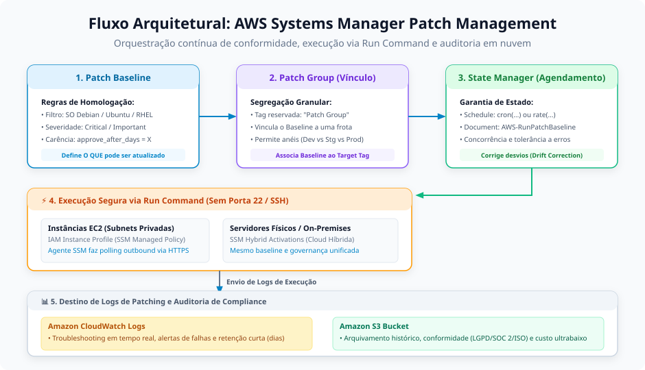
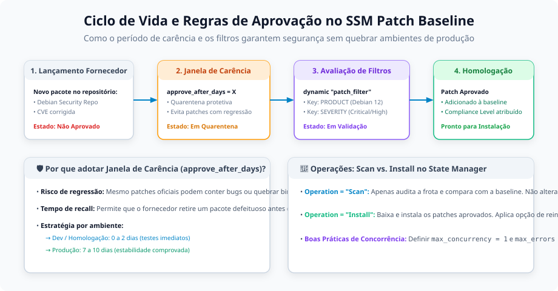
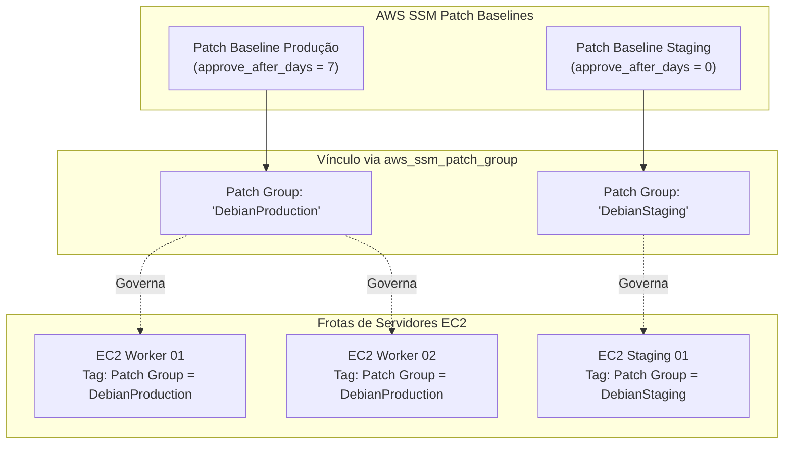

# Anotações de Estudo: Gerenciamento e Patching com AWS Systems Manager (SSM)

Este documento aprofunda os conceitos de governança, automação e aplicação contínua de atualizações de segurança em frotas de servidores através do **AWS Systems Manager (SSM)**, conectando os fundamentos teóricos à implementação real de conformidade no módulo `server` deste repositório.

---

## 1. Visão Geral do AWS Systems Manager (SSM)

O **AWS Systems Manager (SSM)** é a central unificada de gerenciamento de operações, governança e conformidade da AWS para ambientes em nuvem e híbridos.



### O Paradigma Operacional Zero Trust
Historicamente, tarefas de gerenciamento de servidores exigiam:
- Abertura da porta 22 (SSH) ou 3389 (RDP) para a Internet ou via VPN/Bastion Hosts;
- Distribuição e rotação arriscada de chaves privadas `.pem` em computadores locais;
- Execução manual de scripts sem trilha centralizada de auditoria.

Com o SSM, esse modelo foi completamente substituído:
1. **Comunicação Segura de Saída (Outbound-Only)**: O agente local (`amazon-ssm-agent`) comunica-se com os endpoints do SSM através da porta HTTPS (443) com tráfego exclusivamente de saída. **Nenhuma porta de entrada precisa ser aberta no Security Group**;
2. **Autenticação Centralizada via IAM**: Todas as permissões são validadas através de IAM Roles e temporárias concedidas pelo AWS Security Token Service (STS);
3. **Auditoria Integral**: Toda sessão, comando e aplicação de patch é logada e auditável no AWS CloudTrail, Amazon CloudWatch e Amazon S3.

### Suporte Híbrido: EC2 e Servidores On-Premises
O escopo do SSM não se restringe a instâncias virtuais EC2 na AWS:
- Através do recurso **SSM Hybrid Activations**, é possível gerar credenciais de registro (`Activation Code` e `Activation ID`);
- Instalando o agente `amazon-ssm-agent` em servidores físicos locais (On-Premises), máquinas virtuais VMware ou servidores em outros provedores de nuvem, esses nós passam a ser gerenciados exatamente sob as mesmas políticas e regras de conformidade que as instâncias nativas da AWS.

---

## 2. Patch Baseline e Regras de Aprovação Automática

O **Patch Baseline** é o componente declarativo onde são definidas quais atualizações de software do sistema operacional são homologadas e autorizadas para instalação nos servidores da organização.



### Baselines Pré-definidas vs. Baselines Customizadas
- **Baselines Pré-definidas pela AWS**: A AWS disponibiliza baselines padrão para as principais distribuições do mercado (`AWS-DebianDefaultPatchBaseline`, `AWS-AmazonLinux2DefaultPatchBaseline`, `AWS-UbuntuDefaultPatchBaseline`, etc.).
- **Baselines Customizadas (Recomendado para Produção)**: Permitem que a equipe de engenharia controle a granularidade exata:
  - Definir o sistema operacional alvo (`operating_system = "DEBIAN"`);
  - Limitar as atualizações apenas a patches de segurança (`approved_patches_enable_non_security = false`), evitando mudanças de comportamento no sistema;
  - Estabelecer níveis de conformidade (*Compliance Level*: `CRITICAL`, `HIGH`, `MEDIUM`);
  - Configurar janelas de carência protetivas (*Auto-approval Delay*).

### A Importância da Janela de Carência (`approve_after_days`)
Um dos maiores riscos na sustentação de ambientes de produção é a aplicação cega de pacotes no dia de seu lançamento (*Day 0*):
- Não é incomum que atualizações de bibliotecas oficiais introduzam regressões inesperadas de compatibilidade ou quebrem binários em produção;
- Ao configurar `approve_after_days = 7` (ou mais), cria-se uma janela de quarentena: a aprovação só ocorre se o patch permanecer estável nos repositórios pelo período estipulado, permitindo que a comunidade ou o fornecedor identifique e retire pacotes problemáticos.

### Implementação Real no Projeto NSSE: `ssm.patching.baseline.tf`
No módulo `server`, o baseline customizado para Debian 12 é provisionado utilizando Terraform com blocos dinâmicos aninhados:

```hcl
resource "aws_ssm_patch_baseline" "this" {
  name                                 = "DebianProductionBaseLine"
  description                          = "Patch Baseline for Debian Production Environment"
  operating_system                     = "DEBIAN"
  approved_patches_enable_non_security = false

  dynamic "approval_rule" {
    for_each = var.debian_production_patch_baseline

    content {
      approve_after_days = approval_rule.value.approve_after_days
      compliance_level   = approval_rule.value.compliance_level

      dynamic "patch_filter" {
        for_each = approval_rule.value.patch_filters

        content {
          key    = patch_filter.value.key
          values = patch_filter.value.values
        }
      }
    }
  }
}
```

---

## 3. Patch Groups e Segregação de Frotas

Em infraestruturas reais, categorizar servidores apenas por tags genéricas (ex: `Environment = production`) costuma ser insuficiente para operações seguras de patching.

### O Problema do Agrupamento Genérico
Imagine uma frota de 10 instâncias com a tag `Environment = production`:
- Se todas forem atualizadas no mesmo instante e houver necessidade de reinicialização (*reboot*), o serviço enfrentará indisponibilidade massiva;
- Máquinas com funções distintas (ex: nós de banco de dados vs. nós de API web) requerem janelas de manutenção e baselines de aprovação diferentes.

### O Papel da Tag Reservada `Patch Group`
O AWS Systems Manager utiliza uma chave de tag reservada chamada **`Patch Group`**:
1. O **Patch Baseline** é registrado a um determinado grupo através do recurso `aws_ssm_patch_group`;
2. As instâncias EC2 recebem uma tag com chave exata `Patch Group` e valor correspondente (ex: `DebianProduction` ou `WebRingA`);
3. Ao executar a verificação ou instalação, o SSM vincula imediatamente a máquina ao baseline específico registrado para aquele grupo.



### Implementação Real no Projeto NSSE: `ssm.patching.patch-group.tf`

```hcl
resource "aws_ssm_patch_group" "this" {
  baseline_id = aws_ssm_patch_baseline.this.id
  patch_group = var.patch_group
}
```

---

## 4. Orquestração: State Manager vs. Run Command e Documentos SSM

Para entender a automação de patching no Systems Manager, é fundamental compreender a separação de responsabilidades entre três conceitos: **SSM Documents**, **Run Command** e **State Manager**.

### SSM Documents (O Catálogo de Ações)
O **SSM Document** é o equivalente na AWS a um *Playbook* do Ansible ou um manifesto do Puppet. É um arquivo estruturado em formato YAML ou JSON que define:
- Parâmetros aceitos na execução (ex: `Operation`, `RebootOption`);
- Passos sequenciais de execução a serem interpretados pelo agente;
- Para o gerenciamento de patches, a AWS disponibiliza e mantém o documento nativo oficial: **`AWS-RunPatchBaseline`**.

### Run Command (O Executor Imperativo)
- O **Run Command** é o motor que efetivamente executa comandos remotos e documentos SSM nas máquinas;
- Opera de forma imperativa: dispara ações sob demanda ou disparadas por eventos, enviando o comando aos agentes sem a necessidade de conexões SSH ou portas de entrada abertas.

### State Manager (O Controlador Declarativo de Estado Desejado)
- O **State Manager** garante que a infraestrutura permaneça no **estado desejado** continuamente;
- Agenda validações periódicas através de expressões `cron(...)` ou `rate(...)`;
- **Detecção e Correção de Desvio (*Drift Correction*)**: Se alguém acessar o servidor manualmente e remover um pacote ou se uma máquina reiniciar e perder conformidade, o State Manager detecta a discrepância e reexecuta o documento para restabelecer a conformidade;
- Não executa scripts diretamente: ele orquestra associações que delegam a execução ao Run Command.

### Implementação Real no Projeto NSSE: `ssm.patching.association.tf`

```hcl
resource "aws_ssm_association" "debian_production" {
  name             = "AWS-RunPatchBaseline"
  association_name = "DebianRunPatchAssociation"

  # Execução periódica a cada 30 minutos via expressão cron
  schedule_expression = "cron(*/30 * * * ? *)"

  # Controle de concorrência e impacto
  max_concurrency = 1 # Executa em uma máquina por vez (evita queda simultânea)
  max_errors      = 0 # Se 1 máquina falhar, aborta a execução no restante da frota

  # Parâmetros passados ao documento SSM AWS-RunPatchBaseline
  parameters = {
    Operation    = "Install"         # Pode ser "Scan" (auditoria) ou "Install" (instalação)
    RebootOption = "RebootIfNeeded"  # Reinicia o servidor apenas se o patch exigir (ex: novo kernel)
  }

  # Segmentação de alvos baseada na tag reservada Patch Group
  targets {
    key    = "tag:Patch Group"
    values = [var.patch_group]
  }
}
```

> [!TIP]
> **Estratégia de Parâmetros**:
> - Utilize `Operation = "Scan"` em auditorias diárias contínuas para detectar máquinas desatualizadas sem alterar pacotes em produção;
> - Utilize `Operation = "Install"` dentro de janelas de manutenção autorizadas (*Maintenance Windows*) com `RebootOption = "RebootIfNeeded"`.

---

## 5. Auditoria, Governança e Destino de Logs (CloudWatch vs. Amazon S3)

O registro detalhado das execuções de patching é um requisito indispensável para compliance regulatório e auditorias de segurança (ISO 27001, SOC 2, PCI-DSS e LGPD).

### Estratégia Dual de Logs: Por que Utilizar Dois Destinos?

| Destino | Finalidade Principal | Características | Retenção Típica |
| :--- | :--- | :--- | :--- |
| **Amazon CloudWatch Logs** | **Troubleshooting Operacional e Métricas** | - Streams de log em tempo real;<br/>- Busca rápida via CloudWatch Insights;<br/>- Criação de alertas de erro e painéis de monitoramento. | Curta a média (7 a 30 dias) |
| **Amazon S3 Bucket** | **Auditoria Regulatória e Histórico de Conformidade** | - Custo por gigabyte muito menor que CloudWatch;<br/>- Armazenamento em formato gzip imutável;<br/>- Suporte a regras de ciclo de vida (transição para S3 Glacier). | Longo prazo (1 a 7 anos) |

### Como Configurar o Destino de Logs na Associação do State Manager

Para habilitar a exportação simultânea para CloudWatch e S3 em uma associação do SSM, adiciona-se o bloco `output_location`:

```hcl
resource "aws_ssm_association" "debian_production_with_logs" {
  name             = "AWS-RunPatchBaseline"
  association_name = "DebianRunPatchAssociation"
  
  schedule_expression = "cron(0 2 ? * SUN *)" # Todo domingo às 02h00 UTC
  max_concurrency     = 1
  max_errors          = 0

  parameters = {
    Operation    = "Install"
    RebootOption = "RebootIfNeeded"
  }

  targets {
    key    = "tag:Patch Group"
    values = [var.patch_group]
  }

  # Configuração de destino de logs para governança e auditoria
  output_location {
    s3_bucket_name = "nsse-ssm-patching-logs-archive"
    s3_key_prefix  = "patch-history/"

    # Opcional: exportação integrada para CloudWatch Logs
    # (Suportado nativamente em associações e execuções via Maintenance Window)
  }
}
```

### Resumo de Boas Práticas de Engenharia
1. **Nunca utilize credenciais estáticas nem portas SSH expostas**: Gerencie sempre via SSM com IAM Instance Profile;
2. **Defina sempre um período de quarentena (`approve_after_days`)**: Proteja seus ambientes contra falhas imprevistas em atualizações de fornecedores;
3. **Segregue por `Patch Group`**: Isole frotas de homologação, produção e camadas críticas;
4. **Controle a concorrência**: Configure `max_concurrency` proporcional à redundância da frota e interrompa a automação com `max_errors = 0` diante da primeira instabilidade detectada;
5. **Centralize e arquive logs**: Use CloudWatch para análise imediata e S3 para atendimento a auditorias de segurança e LGPD.
