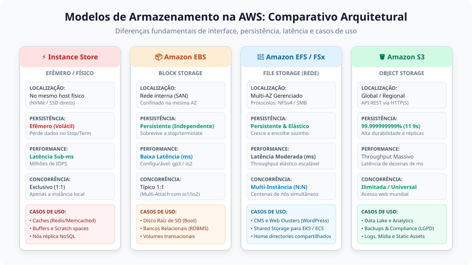
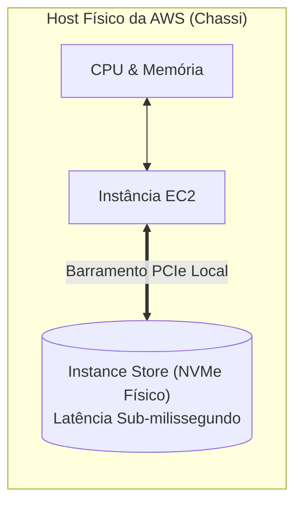
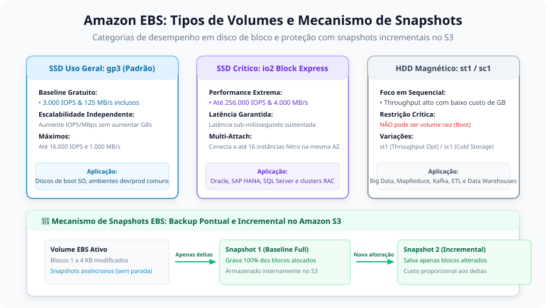
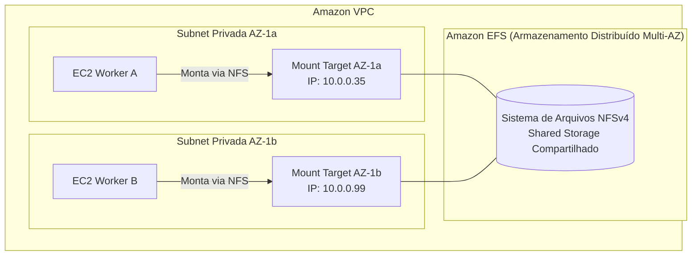

# Anotações de Estudo: Modelos de Armazenamento na AWS (Storage)

Este documento reúne conceitos arquiteturais, características operacionais e boas práticas de desenvolvimento sobre os quatro principais modelos de armazenamento na **Amazon Web Services (AWS)**: **Instance Store**, **Amazon EBS**, **Amazon EFS** e **Amazon S3**.

---

## 1. Visão Geral e Matriz Comparativa de Armazenamento

Na nuvem da AWS, a escolha do serviço de armazenamento adequado impacta diretamente a latência, a resiliência, a concorrência de acesso e a estrutura de custos da infraestrutura.



### Matriz Comparativa entre os Modelos

| Dimensão | Instance Store | Amazon EBS | Amazon EFS / FSx | Amazon S3 |
| :--- | :--- | :--- | :--- | :--- |
| **Modelo** | Armazenamento de Bloco Efêmero | Armazenamento de Bloco Persistente | Armazenamento de Arquivos em Rede | Armazenamento de Objetos |
| **Localização Física** | Discos físicos (NVMe/SSD) no mesmo chassi do host EC2 | Storage virtualizado anexado via rede interna do datacenter | Sistema de arquivos distribuído gerenciado em múltiplas AZs | Infraestrutura global/regional independente de instâncias |
| **Persistência** | **Efêmera (Volátil)**: dados são perdidos em parada (*stop*) ou rescisão (*terminate*) | **Persistente**: desacoplado do ciclo de vida da máquina virtual | **Persistente e Elástico**: dados preservados indefinidamente | **Persistente (11 noves de durabilidade)**: 99.999999999% |
| **Interface / Protocolo** | Barramento PCIe / SATA / NVMe local | Dispositivo de bloco cru (`/dev/xvda`, `/dev/nvme0n1`) | Rede: NFSv4 (EFS) ou SMB/CIFS (FSx Windows) | Web: API REST via HTTP/HTTPS (`GET`, `PUT`, `DELETE`) |
| **Concorrência** | Exclusivo (1:1 com a instância física) | Típico 1:1 (*Multi-Attach* restrito a io1/io2 na mesma AZ) | **Muitos para Muitos (N:N)**: centenas de instâncias e contêineres | **Universal / Ilimitado**: qualquer cliente autorizado via HTTP |
| **Latência Típica** | Sub-milissegundo (&micro;s) | Baixa (1 a 5 ms) | Moderada (milissegundos) | Dezenas a centenas de milissegundos |
| **Custo Relativo** | Incluso no custo de instâncias suportadas | Médio (cobrado por GB alocado + IOPS/throughput provisionado) | Médio-Alto (cobrado por dados armazenados ou leitura/escrita) | Baixo a Ultrabaixo (camadas frias e arquivamento Glacier) |

---

## 2. Instance Store (Armazenamento Físico e Efêmero)

O **Amazon EC2 Instance Store** consiste em unidades de estado sólido (NVMe ou SSD) ou discos magnéticos acoplados **fisicamente** ao hardware do servidor em que a instância virtual EC2 está em execução.

### Características Arquiteturais
- **Latência Mínima e Alto Throughput**: Como o disco está plugado diretamente na placa-mãe/barramento PCIe do servidor físico (sem atravessar a rede do datacenter), ele atinge taxas de IOPS extraordinárias e latência na casa dos microssegundos.
- **Sensibilidade a I/O Extremo**: Projetado para cargas de trabalho que demandam escrita e leitura agressivas de arquivos temporários e caches.



### Ciclo de Vida e Regras de Persistência
A natureza do Instance Store é estritamente **volátil** e atrelada ao ciclo de vida do hardware subjacente:

| Ação na Instância EC2 | O que acontece com os dados no Instance Store? |
| :--- | :--- |
| **Reboot do Sistema Operacional** | **Os dados são preservados**. O hardware físico não muda. |
| **Stop / Start da Instância** | **OS DADOS SÃO IRREVERSIVELMENTE PERDIDOS**. A AWS desocupa o host físico e reloca a máquina em outro chassi. |
| **Terminate (Exclusão)** | **OS DADOS SÃO APAGADOS** e os blocos são sanitizados por segurança. |
| **Falha de Hardware no Host** | **OS DADOS SÃO PERDIDOS** com a indisponibilidade física da unidade. |

> [!WARNING]
> **Nunca armazene dados de negócio ou bancos relacionais primários em Instance Store** sem camadas de replicação contínua. Para dados que exigem persistência confiável, utilize o **Amazon EBS**.

### Casos de Uso Recomendados
1. **Caches em Memória e SSD**: Servidores Redis, Memcached ou Varnish que usam o disco como camada de troca rápida;
2. **Espaço de Scratch e Compilação**: Buffers para pipelines de renderização de vídeo, builds de software massivas e processamento de imagens;
3. **Bancos Não Relacionais com Replicação Distribuída na Aplicação**: Tecnologias como Apache Cassandra, ScyllaDB ou Elasticsearch, onde os nós formam um cluster resiliente e cada máquina mantém uma réplica independente dos dados.

---

## 3. Amazon EBS (Elastic Block Store - Armazenamento em Bloco)

O **Amazon Elastic Block Store (EBS)** fornece volumes de armazenamento em nível de bloco persistentes e de alto desempenho, projetados para serem utilizados em conjunto com as instâncias EC2.



### Como Funciona o Armazenamento em Bloco
- **Granularidade de 1 KB a 4 KB**: Diferente do armazenamento de objetos (onde qualquer mudança exige reenviar o arquivo inteiro), o armazenamento em bloco divide os dados em pedaços atômicos uniformes (blocos).
- **Modificações Pontuais (*In-Place Updates*)**: Se um único registro de um banco de dados de 500 GB for atualizado em uma linha, o sistema operacional grava apenas o bloco de 4 KB correspondente na rede, garantindo alta eficiência de I/O.
- **Dispositivo Cru (*Raw Device*)**: O volume EBS é entregue à máquina virtual como um disco cru não formatado (ex: `/dev/xvda` ou `/dev/nvme1n1`). O administrador precisa criar a tabela de partições e formatá-lo com um sistema de arquivos apropriado:
  - **Linux**: `ext4`, `xfs`, `btrfs`;
  - **Windows**: `NTFS`, `ReFS`.

### Famílias de Volumes EBS

#### 1. SSD de Uso Geral: `gp3` (Recomendado para Nova Infraestrutura)
- **Baseline Incluso sem Custo Adicional**: 3.000 IOPS e 125 MB/s de vazão (*throughput*), independentemente do tamanho contratado em GB.
- **Desacoplamento de Performance e Capacidade**: No modelo anterior (`gp2`), o volume precisava ter centenas de gigabytes para conseguir IOPS suficiente (3 IOPS por GB). No `gp3`, é possível provisionar um disco pequeno de 20 GB com 5.000 IOPS de forma independente e com custo até 20% menor por GB.

#### 2. SSD de IOPS Provisionado: `io2` Block Express
- Desempenho extremo para bancos de dados críticos (Oracle, SAP HANA, Microsoft SQL Server).
- Suporta até **256.000 IOPS**, **4.000 MB/s** e latência sustentada abaixo de 1 milissegundo.
- **EBS Multi-Attach**: Permite anexar o mesmo volume `io2` simultaneamente em até 16 instâncias EC2 baseadas no sistema AWS Nitro na mesma Zona de Disponibilidade, ideal para clusters com sistemas de arquivos clusterizados (ex: GFS2, OCFS2).

#### 3. HDD Otimizado para Throughput: `st1` e Cold HDD: `sc1`
- Discos magnéticos de baixo custo focados em grandes fluxos de leitura e gravação sequencial (Big Data, MapReduce, Apache Kafka, Log Warehousing).
- > [!IMPORTANT]
  > Volumes dos tipos `st1` e `sc1` **NÃO podem ser utilizados como volume de inicialização (Boot/Root Volume)** do sistema operacional.

### Mecanismo de Snapshots Incrementais no Amazon S3
Os backups de volumes EBS são realizados através de **Snapshots**:
- O primeiro snapshot faz uma cópia completa de todos os blocos alocados;
- Os snapshots subsequentes são **estritamente incrementais**, salvando apenas os blocos de 4 KB que sofreram mutação desde o último snapshot;
- Os dados do snapshot são armazenados internamente pela AWS dentro do **Amazon S3**, usufruindo da durabilidade de 11 noves sem cobrar o preço de armazenamento do EBS.

### Exemplo em Terraform: Configuração de Volume Raiz e Volume Adicional

```hcl
# Definição do volume raiz no Launch Template
resource "aws_launch_template" "this" {
  name_prefix   = "nsse-app-"
  image_id      = data.aws_ami.debian.id
  instance_type = "t3.micro"

  block_device_mappings {
    device_name = "/dev/xvda"

    ebs {
      volume_size           = 20
      volume_type           = "gp3"
      iops                  = 3000
      throughput            = 125
      delete_on_termination = true
      encrypted             = true
    }
  }
}

# Criação de um volume de dados persistente dedicado
resource "aws_ebs_volume" "data" {
  availability_zone = "us-east-1a"
  size              = 50
  type              = "gp3"
  encrypted         = true

  tags = {
    Name        = "app-data-persistent"
    Environment = "production"
  }
}

# Associação do volume à instância EC2
resource "aws_volume_attachment" "this" {
  device_name = "/dev/sdf"
  volume_id   = aws_ebs_volume.data.id
  instance_id = aws_instance.worker.id
}
```

---

## 4. Armazenamento em Arquivos Compartilhados (Amazon EFS e Amazon FSx)

Quando múltiplas máquinas precisam acessar, ler e modificar a mesma estrutura de diretórios e arquivos concorrentemente, o modelo de blocos isolados do EBS deixa de atender. Para esse cenário, a AWS fornece serviços gerenciados de **File Storage em Rede**.

### Amazon EFS (Elastic File System)
- **Protocolo Padrão**: Baseado em **NFSv4** (*Network File System*), compatível com a semântica POSIX de sistemas operacionais baseados em Linux.
- **Concorrência Massiva (N:N)**: Centenas de instâncias EC2, nós de Auto Scaling, contêineres ECS e pods de Kubernetes (EKS) podem montar o mesmo diretório compartilhado simultaneamente.
- **Elasticidade Total**: Cresce e diminui automaticamente à medida que arquivos são criados ou excluídos. Não há necessidade de provisionar antecipadamente o tamanho em gigabytes ou terabytes.
- **Multi-AZ por Padrão**: O EFS replica os dados de forma transparente em múltiplas Zonas de Disponibilidade dentro da Região, garantindo alta disponibilidade mesmo diante da perda de um datacenter inteiro.



### Amazon FSx: Soluções Especializadas de Arquivo
Para ecossistemas que não utilizam Linux/NFS nativo, a AWS disponibiliza a família **Amazon FSx**:
- **FSx for Windows File Server**: Sistema de arquivos nativo do Windows construído sobre **SMB (Server Message Block)**, com integração direta ao Microsoft Active Directory, permissões NTFS e DFS.
- **FSx for Lustre**: Otimizado para computação de alto desempenho (HPC), inteligência artificial, renderização gráfica e machine learning, oferecendo centenas de gigabytes por segundo de vazão com latência sub-milissegundo.
- **FSx for NetApp ONTAP & OpenZFS**: Para migração de infraestruturas legadas de storage corporativo mantendo recursos como desduplicação e compressão de hardware.

### Procedimento de Montagem no Linux e Exemplo Terraform
No Debian/Ubuntu, a montagem pode ser feita via pacote utilitário oficial:

```bash
# 1. Instalação do cliente de montagem da AWS
sudo apt-get update && sudo apt-get install -y amazon-efs-utils

# 2. Criação do ponto de montagem e conexão via protocolo seguro (TLS)
sudo mkdir -p /mnt/shared-data
sudo mount -t efs -o tls fs-0123456789abcdef0:/ /mnt/shared-data
```

Exemplo básico de provisionamento com Terraform:

```hcl
resource "aws_efs_file_system" "shared" {
  creation_token   = "nsse-shared-efs"
  performance_mode = "generalPurpose"
  throughput_mode  = "bursting"
  encrypted        = true

  tags = {
    Name = "nsse-shared-efs"
  }
}

resource "aws_efs_mount_target" "az_a" {
  file_system_id  = aws_efs_file_system.shared.id
  subnet_id       = data.aws_subnets.private_subnets.ids[0]
  security_groups = [aws_security_group.efs.id]
}
```

---

## 5. Amazon S3 (Simple Storage Service - Armazenamento de Objetos)

O **Amazon S3** é o serviço de armazenamento em nuvem mais maduro e amplamente adotado da AWS, projetado para armazenar e recuperar qualquer volume de dados a partir de qualquer local na Internet ou na VPC.

### O Paradigma do Armazenamento de Objetos
Diferente de sistemas de blocos ou diretórios hierárquicos tradicionais:
- Os arquivos não são salvos em árvores de pastas nativas de um sistema operacional;
- Cada unidade de dado é tratada como um **Objeto** armazenado em um recipiente universal denominado **Bucket**;
- Cada objeto contém quatro elementos essenciais:
  1. **Chave (*Key*)**: O identificador único ou caminho lógico do objeto (ex: `backups/2026/database.tar.gz`);
  2. **Dados (*Value*)**: A sequência de bytes brutos do arquivo;
  3. **Metadados (*Metadata*)**: Pares chave-valor que descrevem o arquivo (ex: `Content-Type: application/json`, autor, data de expiração ou tags personalizadas);
  4. **ID de Versão (*Version ID*)**: Identificador único caso o versionamento do bucket esteja habilitado.

### Acesso Universal via API REST HTTP(S)
A comunicação com o S3 não utiliza protocolos de montagem de sistema de arquivos como NFS ou iSCSI. Todas as interações ocorrem através de requisições web seguras autenticadas pelo IAM:
- `GET /bucket/chave` &rarr; Download do objeto;
- `PUT /bucket/chave` &rarr; Envio de um novo objeto;
- `DELETE /bucket/chave` &rarr; Remoção do objeto.

### Durabilidade de 11 Noves (99.999999999%)
A arquitetura do S3 distribui automaticamente os objetos por pelo menos três Zonas de Disponibilidade fisicamente independentes. Isso garante que a perda acidental de múltiplos datacenters em uma mesma região não resulte em perda definitiva de dados.

### Classes de Armazenamento e Gestão de Ciclo de Vida (*Lifecycle*)

A AWS disponibiliza diferentes classes de armazenamento para equilibrar custo e velocidade de recuperação:

| Classe de Armazenamento | Padrão de Acesso | Tempo de Recuperação | Custo de Armazenamento |
| :--- | :--- | :--- | :--- |
| **S3 Standard** | Acesso frequente diário | Imediato (milissegundos) | Padrão |
| **S3 Intelligent-Tiering** | Padrões de acesso imprevisíveis ou variáveis | Imediato (sem taxa de recuperação) | Automatizado por machine learning |
| **S3 Standard-IA** | Acesso pouco frequente (ex: 1x por mês) | Imediato (milissegundos) | Menor custo de GB; taxa por leitura |
| **S3 One Zone-IA** | Dados secundários recriáveis em 1 única AZ | Imediato (milissegundos) | ~20% mais barato que Standard-IA |
| **S3 Glacier Flexible** | Backups frios e retenção regulatória | 1 a 5 minutos (Expedited) ou 3 a 5 horas | Ultrabaixo custo de GB |
| **S3 Glacier Deep Archive** | Arquivamento de longo prazo (compliance LGPD / 7+ anos) | 12 a 48 horas | O menor custo de armazenamento na AWS |

### Exemplo em Terraform: Bucket com Regra de Ciclo de Vida para Conformidade e LGPD

```hcl
resource "aws_s3_bucket" "compliance_logs" {
  bucket        = "nsse-compliance-audit-logs-archive"
  force_destroy = false

  tags = {
    Environment = "production"
    Governance  = "LGPD-Compliance"
  }
}

# Bloqueio estrito de acesso público (Boas Práticas de Segurança)
resource "aws_s3_bucket_public_access_block" "this" {
  bucket = aws_s3_bucket.compliance_logs.id

  block_public_acls       = true
  block_public_policy     = true
  ignore_public_acls      = true
  restrict_public_buckets = true
}

# Versionamento para proteção contra exclusão acidental ou ransomware
resource "aws_s3_bucket_versioning" "this" {
  bucket = aws_s3_bucket.compliance_logs.id
  versioning_configuration {
    status = "Enabled"
  }
}

# Regra de ciclo de vida automática para redução contínua de custos
resource "aws_s3_bucket_lifecycle_configuration" "retention" {
  bucket = aws_s3_bucket.compliance_logs.id

  rule {
    id     = "transicao-glacier-e-expiracao"
    status = "Enabled"

    # Move logs ativos para Standard-IA após 30 dias
    transition {
      days          = 30
      storage_class = "STANDARD_IA"
    }

    # Move para o Glacier Flexible após 90 dias
    transition {
      days          = 90
      storage_class = "GLACIER"
    }

    # Move para Deep Archive após 180 dias
    transition {
      days          = 180
      storage_class = "DEEP_ARCHIVE"
    }

    # Exclui definitivamente após 7 anos (2555 dias) para atendimento a compliance
    expiration {
      days = 2555
    }
  }
}
```
