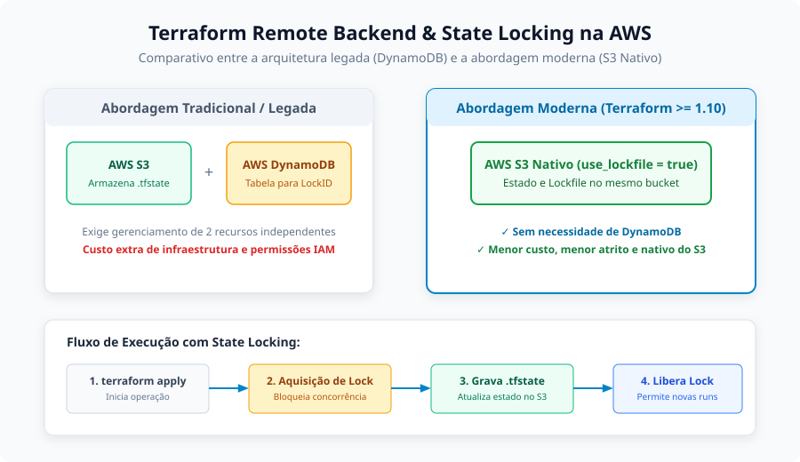
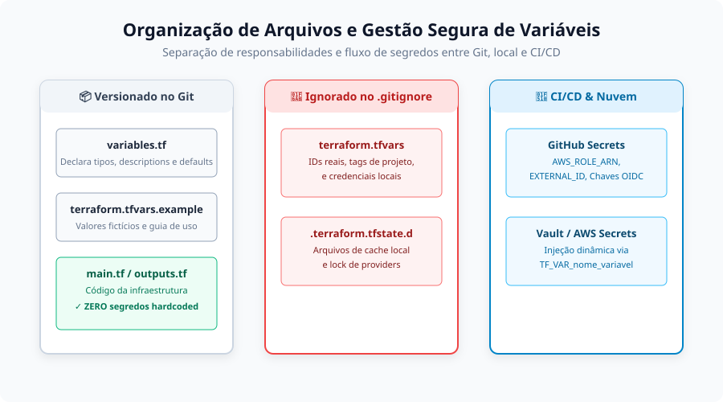
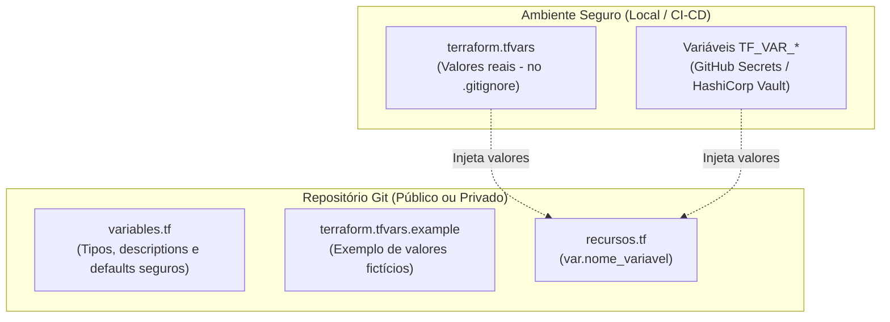
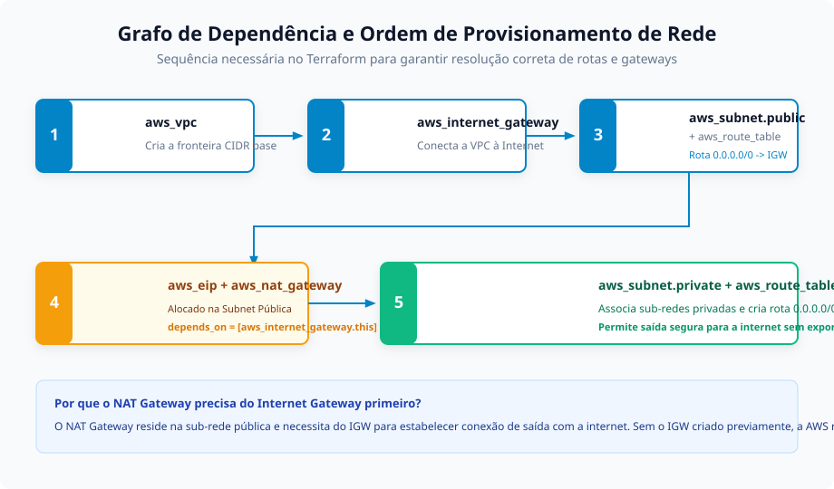
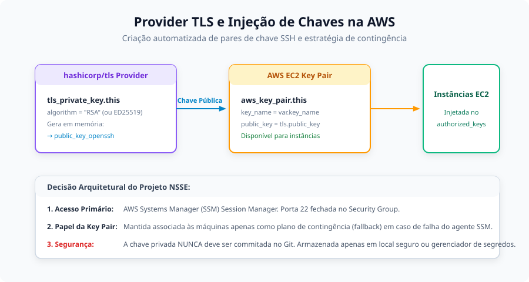

# Anotações de Estudo: Terraform e Boas Práticas na AWS

Este documento reúne anotações conceituais, decisões arquiteturais e boas práticas de desenvolvimento em **Terraform** aplicadas ao provisionamento de infraestrutura na **AWS**.

---

## 1. Remote Backend e State Locking na AWS

O arquivo de estado (`terraform.tfstate`) é o coração do Terraform: ele mapeia os recursos declarados no código contra a infraestrutura real provisionada na nuvem. Em ambientes profissionais ou de equipe, armazenar o estado localmente no computador do desenvolvedor é arriscado devido ao risco de perda de dados, vazamento de segredos e concorrência desordenada.



### Comparativo: Abordagem Legada vs. Abordagem Moderna

#### Abordagem Tradicional (Legada)
Historicamente na AWS, a configuração de um backend remoto com trava de concorrência (*state locking*) exigia dois serviços distintos:
1. **AWS S3 Bucket**: Armazenava o arquivo `.tfstate` com criptografia em repouso e versionamento ativado.
2. **AWS DynamoDB Table**: Utilizada exclusivamente para armazenar uma chave de partição (`LockID`), evitando que duas pessoas ou pipelines executassem `terraform apply` simultaneamente e corrompessem o estado.

> [!NOTE]
> Nas anotações iniciais foi citado MongoDB, mas na AWS o serviço gerenciado NoSQL padrão utilizado para essa finalidade sempre foi o **Amazon DynamoDB**.

#### Abordagem Moderna (Terraform >= 1.10 e 1.11+)
A partir do Terraform 1.10, o provider AWS e o core do Terraform introduziram suporte nativo a *state locking* diretamente no **Amazon S3** através de locks baseados em objetos (`use_lockfile = true`), **dispensando completamente a criação da tabela DynamoDB**:

```hcl
terraform {
  required_version = "> 1.11.0"

  backend "s3" {
    bucket       = "nsse-tf-state-files-guilermiiii" # Nome fixo e único globalmente
    key          = "prod/network.tfstate"           # Caminho do estado segregado
    region       = "us-east-1"
    encrypt      = true
    use_lockfile = true                             # State locking nativo do S3 (sem DynamoDB!)
  }

  required_providers {
    aws = {
      source  = "hashicorp/aws"
      version = "~> 6.0"
    }
  }
}
```

### Vantagens do Lock Nativo no S3
- **Redução de Custos e Complexidade**: Não é mais necessário provisionar nem pagar pela capacidade de leitura/escrita de uma tabela DynamoDB.
- **Menor Superfície de Permissões**: Apenas permissões do IAM para o S3 são requeridas na role da pipeline.
- **Migração Transparente**: Para migrar de um backend existente ou local para o S3:
  ```bash
  terraform init -migrate-state
  ```

---

## 2. Organização de Arquivos, Variáveis e Gestão de Segredos

Uma das regras de ouro no Terraform é a **modularidade e separação de responsabilidades**, evitando arquivos monolíticos gigantes.



### Padrão de Separação de Arquivos
- **`main.tf`**: Ponto de entrada com o bloco `terraform {}`, backend e definição de providers.
- **`variables.tf`**: Declaração estrita de todas as variáveis de entrada, seus tipos e descrições explicativas.
- **`outputs.tf`**: Exportação de dados críticos gerados (IDs de VPC, sub-redes, ARNs) para integração com outras camadas.
- **`<servico>.<recurso>.tf`**: Arquivos semânticos dedicados a recursos específicos (ex: `vpc.internet-gateway.tf`, `ec2.instance-profile.tf`).

### Gestão Segura de Variáveis e Segredos
Nunca salve senhas, chaves privadas ou ARNs sensíveis diretamente no código que vai para o Git.



#### Exemplo em `variables.tf`:
```hcl
variable "region" {
  type        = string
  description = "Região da AWS onde os recursos serão provisionados"
  default     = "us-east-1" # Valores seguros podem ter default
}

variable "assume_role" {
  description = "Credenciais para assumir a role de deploy"
  type = object({
    arn         = string
    external_id = string
  })
  sensitive = true # Oculta os valores da saída do terminal e dos logs
}
```

#### Uso de `terraform.tfvars.example` vs `terraform.tfvars`:
- **`terraform.tfvars.example`**: Commitado no repositório. Serve como documentação viva e template para outros engenheiros.
- **`terraform.tfvars`**: **Ignorado obrigatoriamente no `.gitignore`**. Preenchido localmente com dados reais de teste/desenvolvimento.
- **Em Esteiras de CI/CD**: Segredos e ARNs de roles são injetados via variáveis de ambiente da esteira (ex: `TF_VAR_assume_role`) lidas a partir do GitHub Secrets ou AWS Secrets Manager.

---

## 3. Ordem de Dependência e Provisionamento de Rede (Networking Pipeline)

Ao planejar a infraestrutura de rede, o Terraform cria um Grafo Acíclico Direcionado (DAG) para resolver as dependências. No entanto, há dependências arquiteturais fundamentais que precisam ser respeitadas.



### Sequência Lógica de Criação

1. **VPC Base (`aws_vpc`)**: Cria a fronteira do bloco CIDR na nuvem.
2. **Internet Gateway (`aws_internet_gateway`)**: Deve ser criado e acoplado à VPC antes que o tráfego externo ou o NAT Gateway possam existir.
3. **Sub-redes Públicas (`aws_subnet.public`) & Tabela de Rota Pública**:
   - Criação das subnets públicas.
   - Criação da tabela de rotas com a rota padrão `0.0.0.0/0` apontando para o `aws_internet_gateway.this.id`.
   - Associação das subnets públicas à tabela de rotas.
4. **Elastic IPs (`aws_eip`) & NAT Gateways (`aws_nat_gateway`)**:
   - O NAT Gateway **obrigatoriamente deve residir dentro de uma subnet pública**.
   - O NAT Gateway precisa de um Elastic IP alocado.
   - Deve conter a dependência explícita do Internet Gateway:
     ```hcl
     resource "aws_nat_gateway" "this" {
       count         = length(var.vpc.public_subnets)
       allocation_id = aws_eip.this[count.index].id
       subnet_id     = aws_subnet.public[count.index].id

       # Documentação oficial: o NAT Gateway precisa do IGW ativo para funcionar
       depends_on = [aws_internet_gateway.this]
     }
     ```
5. **Sub-redes Privadas (`aws_subnet.private`) & Tabelas de Rota Privadas**:
   - Sub-redes privadas são provisionadas.
   - Criação das tabelas de rotas privadas apontando sua rota `0.0.0.0/0` para o respectivo `nat_gateway_id`.
   - Associação das sub-redes privadas.

---

## 4. Provisionamento de Acesso e Provider TLS

Para gerenciar o acesso administrativo inicial ou situações de contingência em instâncias EC2, é comum configurar pares de chaves SSH (*Key Pairs*).



### Geração Automatizada com `hashicorp/tls`
Em vez de gerar chaves manualmente na máquina local com `ssh-keygen` e enviá-las pelo console da AWS, o Terraform permite gerar a chave programaticamente:

```hcl
# 1. Gera o par de chaves criptográficas em memória
resource "tls_private_key" "this" {
  algorithm = "RSA"
  rsa_bits  = 4096
}

# 2. Registra a chave pública na AWS
resource "aws_key_pair" "this" {
  key_name   = var.ec2_resources.key_pair_name
  public_key = tls_private_key.this.public_key_openssh
}
```

### Decisão Arquitetural do Projeto NSSE
- **Acesso Primário**: O acesso interativo dos desenvolvedores às máquinas EC2 é realizado via **AWS Systems Manager (SSM) Session Manager**. Não há portas SSH (porta 22) abertas na Internet e nenhum Security Group autoriza tráfego SSH externo.
- **Função da Key Pair**: Mantemos a chave associada às instâncias no *Launch Template* como **mecanismo de contingência (fallback)**. Caso o agente SSM pare de responder ou ocorra falha de rede interna, uma sessão de resgate pode ser configurada sem a necessidade de reconstruir os discos da máquina.
